# Heart Disease Risk Prediction: End-to-End MLOps Pipeline

**Course:** Machine Learning Operations (AIMLCZG523), Assignment 1 (50 marks)\
**Student:** Rutuja Arwade  ·  **BITS ID:** _<to be filled in>_\
**Code repository:** <https://github.com/Rutuja-arwade/heart-disease-mlops>\
**Container image:** `ghcr.io/rutuja-arwade/heart-disease-api:latest`\
**CI/CD runs:** <https://github.com/Rutuja-arwade/heart-disease-mlops/actions>\
**Video walkthrough:** `docs/video/pipeline_walkthrough.mp4` (in the repository)

---

## 1. Summary

The goal was a classifier that predicts heart disease from 13 routine clinical attributes (UCI Heart Disease,
Cleveland subset), delivered as a reproducible, tested, containerised and monitored REST API on Kubernetes.

| Area | What was delivered |
|---|---|
| Data | Download script with SHA-256 verification and mirror fallback, explicit cleaning rules, cleaned CSV and a cleaning report |
| EDA | 8 figures (class balance, missingness, histograms, correlation heatmap, target correlations, categorical disease rates, boxplots, age vs heart rate) |
| Modelling | One sklearn `Pipeline` (custom feature builder, imputation, scaling, one-hot encoding). Logistic Regression, Random Forest and Gradient Boosting tuned with stratified 5-fold CV, plus a majority baseline |
| Tracking | MLflow: 4 parent runs, 112 nested trial runs, plots and artifacts per run, model registry with a `champion` alias |
| Packaging | `model.joblib` (full pipeline), MLflow model, metadata JSON with lineage, pinned `requirements*.txt` and `environment.yml` |
| CI/CD | GitHub Actions, 6 jobs: lint → test → train (quality gate) → Docker build and smoke test → kind + Helm deploy → GHCR publish |
| Serving | FastAPI `/predict` (prediction + confidence + risk band), batch endpoint, health and readiness probes, `/metrics` |
| Deployment | Minikube, Helm chart and raw manifests, LoadBalancer and NGINX Ingress, HPA, PDB, non-root and read-only pods |
| Monitoring | JSON request and prediction logs, Prometheus metrics with alert rules, 14-panel Grafana dashboard |

**Champion model:** L2-regularised logistic regression (C = 0.3, balanced class weights).
Mean CV ROC-AUC is **0.907 ± 0.019**. On the held-out test set: **ROC-AUC 0.961, accuracy 0.869, recall 0.929, precision 0.813**.

## 2. Architecture

The system has three layers (Figure 1):

1. **Data and experimentation.** `src/data.py` downloads and cleans the data. `src/eda.py` produces the figures. `src/train.py` tunes
   the models and logs every trial to MLflow. The champion pipeline is exported to `models/`.
2. **CI/CD.** Every push to `main` re-runs the whole chain on a clean GitHub runner. The model is retrained and must pass a
   quality gate. That freshly trained model is baked into the image, and the image is deployed to a throw-away kind cluster and
   smoke-tested. Only then is the image published to GHCR.
3. **Serving and monitoring.** On Minikube a Helm release runs two API pods behind a LoadBalancer Service and an NGINX
   Ingress. Prometheus discovers the pods through annotations and scrapes `/metrics`. Grafana visualises traffic, latency,
   errors and model outputs. Every request is logged as one JSON line.

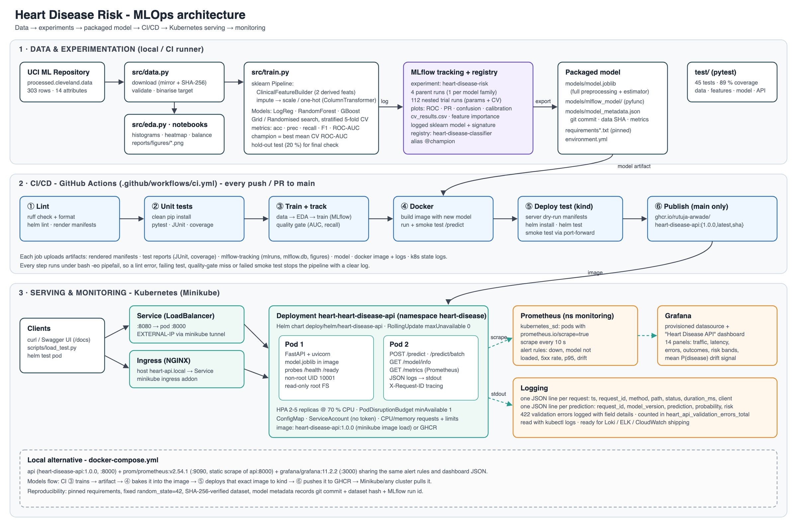

Repository layout:

```
src/            config, data, eda, features, train, evaluate, predict; api/ (app, schemas, monitoring)
data/           raw/ (UCI file) · processed/ (clean CSV + cleaning report) · README (download instructions)
notebooks/      01_eda · 02_model_training · 03_inference (executed, outputs saved)
test/           pytest suite: test_data, test_features, test_model, test_api (45 tests)
models/         model.joblib · mlflow_model/ · model_metadata.json
reports/        figures/ (EDA + model plots) · metrics/ (comparison tables, summaries)
deploy/         k8s/ (kustomize manifests) · helm/heart-disease-api/ (chart, values-ci.yaml, helm test)
monitoring/     prometheus/ (configs, alert rules) · grafana/ (provisioning, dashboard) · k8s/ + kustomization
scripts/        download_data.sh · smoke_test.sh · load_test.py
.github/workflows/ci.yml · Dockerfile · docker-compose.yml · Makefile · requirements*.txt · environment.yml
screenshots/    evidence used in this report · docs/report/ this report · docs/video/ walkthrough
```

## 3. Setup and installation

Prerequisites: Python 3.11 and Docker. Deployment also needs minikube, kubectl and helm. Everything below was run from
a clean virtual environment, and CI repeats the same steps on a fresh Ubuntu runner on every push.

```bash
git clone https://github.com/Rutuja-arwade/heart-disease-mlops.git && cd heart-disease-mlops
python3.11 -m venv .venv && source .venv/bin/activate
pip install -r requirements-dev.txt            # or: conda env create -f environment.yml
python -m src.data       # download + clean   -> data/processed/heart_disease_clean.csv
python -m src.eda        # EDA figures        -> reports/figures/
python -m src.train      # tune + MLflow      -> models/, mlflow.db, mlruns/
pytest                   # 45 unit tests
mlflow ui --backend-store-uri sqlite:///mlflow.db --port 5001
```

Serving and deployment:

```bash
docker build -t heart-disease-api:1.0.0 . && docker run -d -p 8000:8000 heart-disease-api:1.0.0
./scripts/smoke_test.sh http://localhost:8000          # health, predict, 422 check, metrics
docker compose up -d --build                           # API + Prometheus (:9090) + Grafana (:3000)

minikube start --driver=docker --cpus=2 --memory=3900
minikube addons enable ingress && minikube addons enable metrics-server
minikube image load heart-disease-api:1.0.0
helm upgrade --install heart deploy/helm/heart-disease-api -n heart-disease --create-namespace --wait
kubectl apply -k monitoring                            # Prometheus + Grafana in namespace "monitoring"
minikube tunnel                                        # LoadBalancer EXTERNAL-IP 127.0.0.1:8080
```

**Access instructions (local deployment).** The API is not hosted publicly. After the steps above, it is reachable at
`http://127.0.0.1:8080` (Swagger UI at `/docs`) through the LoadBalancer, and at `http://heart-api.local` through the Ingress
(locally: `kubectl -n ingress-nginx port-forward svc/ingress-nginx-controller 8081:80` and send `Host: heart-api.local`).
The CI-built image can also be pulled from `ghcr.io/rutuja-arwade/heart-disease-api:latest`.

## 4. Data acquisition and cleaning

**Source.** UCI Machine Learning Repository, *Heart Disease* (Janosi et al., 1988), file `processed.cleveland.data`:
303 patients, 13 clinical attributes and the diagnosis `num` (0 = no disease, 1-4 = increasing severity). The Cleveland
subset is the standard benchmark because the other three sites have most values of `slope`, `ca` and `thal` missing.

**Acquisition (`src/data.py`, `scripts/download_data.sh`).**

- The script tries the classic UCI URL first and falls back to the zip archive on the new UCI site.
- Each mirror is retried 3 times with back-off.
- The downloaded file is verified against a pinned SHA-256 checksum.
- A verified local copy is reused, so CI does not depend on UCI being available. `--force` downloads again.

**Cleaning rules**, recorded in `data/processed/cleaning_report.json`:

1. `?` is parsed as missing and every column is coerced to numeric.
2. Values outside physiological ranges become missing, for example cholesterol of 0 or a heart rate below 60.
3. Category codes outside the documented levels become missing.
4. The target is binarised: `target = 1` if `num > 0`, otherwise 0.
5. Exact duplicates are dropped.

Result: 303 rows in and 303 out. No duplicates or invalid values were found. 4 rows are missing `ca` and 2 are missing `thal`.

**Missing values** are kept in the clean CSV on purpose. They are imputed inside the model pipeline (median for
continuous, most frequent for categorical), so the imputer is fitted only on training folds (no leakage). The API can then
accept requests without `ca` or `thal`, which need fluoroscopy or a thallium scan that may not be available.

## 5. Exploratory data analysis

| | |
|---|---|
| 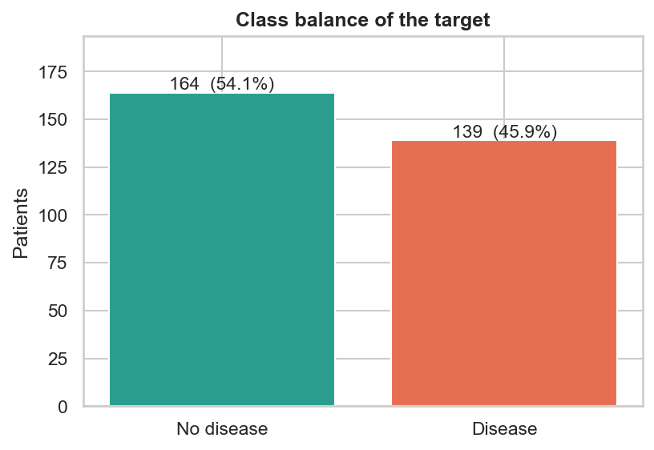 | 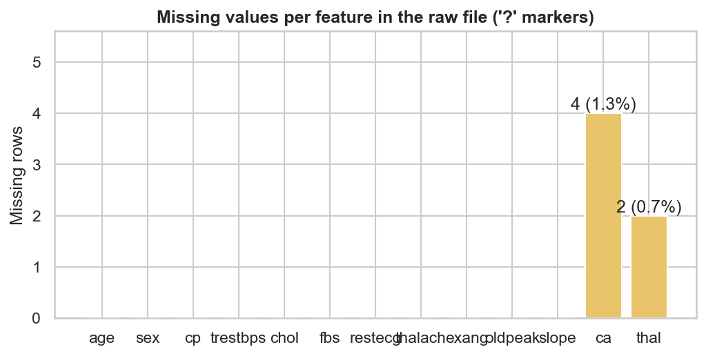 |

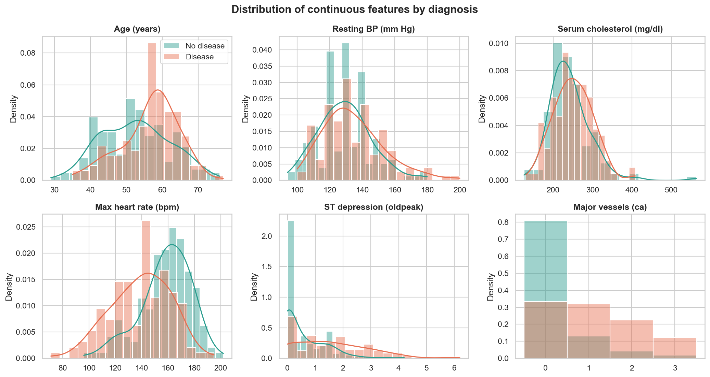

| | |
|---|---|
| 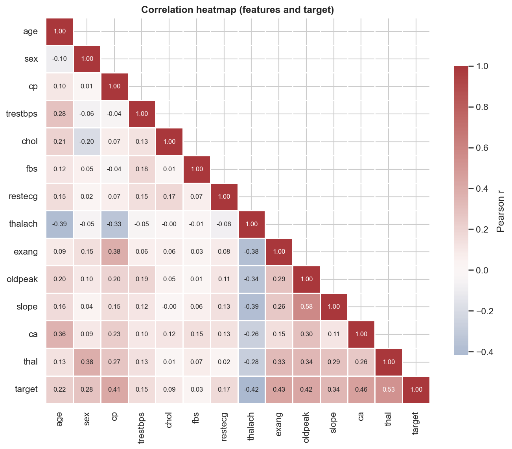 | 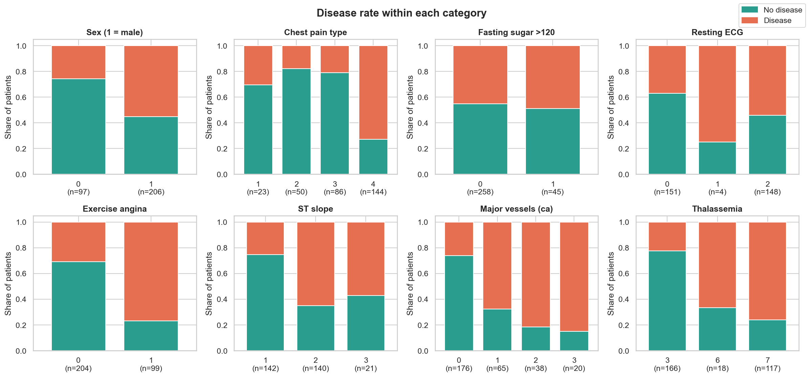 |

Findings and how they shaped the modelling:

- **Class balance:** 164 patients without disease (54.1 %) and 139 with disease (45.9 %), so the classes are nearly balanced.
  Accuracy is meaningful, but the splits are still stratified, recall and ROC-AUC are tracked, and `class_weight` is tuned.
- **Separating features:** patients with disease are older, reach a lower maximum heart rate (`thalach`), show more ST
  depression (`oldpeak`) and have more major vessels coloured by fluoroscopy (`ca`). Cholesterol and resting blood pressure
  overlap heavily between the classes.
- **Correlations with the target:** `thal` 0.53, `ca` 0.46, `exang` 0.43, `oldpeak` 0.42, `thalach` −0.42, `cp` 0.41.
  No pair of predictors has |r| > 0.6, so no feature is dropped for collinearity.
- **Nominal codes behave non-monotonically.** For example, asymptomatic chest pain (`cp = 4`) has a 73 % disease rate,
  against 18-30 % for the other types. So `cp`, `restecg`, `slope` and `thal` are one-hot encoded, not treated as numbers.
- **Outliers:** cholesterol up to 564 mg/dl and `oldpeak` up to 6.2 are clinically plausible, so they are kept and
  handled by scaling and regularisation.
- **Feature idea:** diseased patients fall further below the age-predicted maximum heart rate (220 − age). This motivated
  the engineered feature `hr_achieved_ratio` (Figure 08 in `reports/figures`).

## 6. Feature engineering and preprocessing

Everything lives in one scikit-learn `Pipeline` (`src/features.py`). That pipeline is what gets cross-validated, pickled,
logged to MLflow and loaded by the API, so training and serving cannot diverge.

| Step | Columns | Transformation |
|---|---|---|
| `ClinicalFeatureBuilder` (custom transformer) | `age`, `thalach`, `trestbps` | adds `hr_achieved_ratio = thalach / (220 − age)` and `rate_pressure_index = thalach × trestbps / 1000`. A hyperparameter `enabled` switches it on or off |
| Continuous | `age`, `trestbps`, `chol`, `thalach`, `oldpeak`, `ca` (+ the 2 engineered features) | median imputation → `StandardScaler` |
| Nominal | `cp`, `restecg`, `slope`, `thal` | most-frequent imputation → `OneHotEncoder(handle_unknown="ignore")` |
| Binary | `sex`, `fbs`, `exang` | most-frequent imputation, then passed through |

This gives 24 model inputs with the engineered features and 22 without. Column selection uses callables, so the same
`ColumnTransformer` works whether or not the engineered columns are present.

## 7. Model development and tuning

**Protocol.**

- Stratified 80/20 split: 242 patients for training and 61 held out for testing, `random_state = 42`.
- Every candidate is scored with stratified 5-fold CV on the training split for accuracy, precision, recall, F1 and
  ROC-AUC. `refit = ROC-AUC`.
- The champion family is the one with the highest **mean CV ROC-AUC**, with CV accuracy as the tie-break. Selection never
  uses the test set, so the hold-out score stays an unbiased final estimate.

| Model | Search | Hyperparameter space | Trials |
|---|---|---|---|
| Majority baseline | - | - | 1 |
| Logistic Regression (liblinear) | Grid | C ∈ {0.01, 0.03, 0.1, 0.3, 1, 3, 10} × penalty {L1, L2} × class_weight {None, balanced} × engineered {on, off} | 56 |
| Random Forest | Randomised | n_estimators {200, 400}, max_depth {None, 4, 6, 8}, min_samples_leaf {1, 3, 5}, max_features {sqrt, 0.5}, class_weight, engineered | 30 |
| Gradient Boosting | Randomised | n_estimators {100, 200, 300}, learning_rate {0.01, 0.05, 0.1}, max_depth {2, 3}, subsample {0.7, 1.0}, min_samples_leaf {1, 5, 10}, engineered | 25 |

**Results** (CV columns are 5-fold means on the training split; test columns use the 61-patient hold-out set):

| Model | CV ROC-AUC | CV Acc | CV Prec | CV Recall | CV F1 | Test Acc | Test Prec | Test Recall | Test F1 | Test ROC-AUC |
|---|---|---|---|---|---|---|---|---|---|---|
| **Logistic Regression** | **0.907 ± 0.019** | **0.855** | **0.882** | **0.801** | **0.834** | 0.869 | 0.812 | **0.929** | 0.867 | **0.961** |
| Random Forest | 0.905 ± 0.023 | 0.818 | 0.814 | 0.792 | 0.798 | **0.885** | 0.839 | **0.929** | **0.881** | 0.955 |
| Gradient Boosting | 0.892 ± 0.029 | 0.822 | 0.847 | 0.764 | 0.796 | **0.885** | **0.862** | 0.893 | 0.877 | 0.938 |
| Majority baseline | 0.500 | 0.541 | 0.000 | 0.000 | 0.000 | 0.541 | 0.000 | 0.000 | 0.000 | 0.500 |

| | |
|---|---|
| 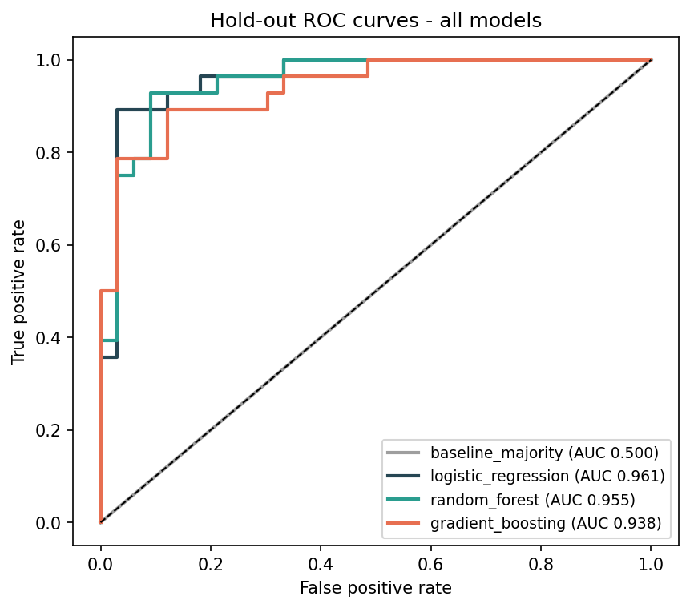 | 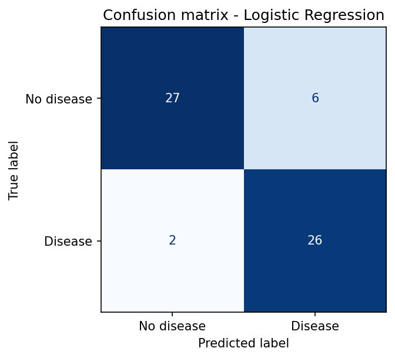 |

**Selection rationale.**

- Logistic regression has the best mean CV ROC-AUC and the lowest variance across folds.
- Random forest is within noise (0.905) and slightly better on hold-out accuracy, but it is larger, slower and harder to
  explain. With equal performance, the simpler and more interpretable model was preferred.
- Best LR configuration: L2 penalty, C = 0.3, balanced class weights.
- On the test set the champion misses only 2 of 28 patients with disease (recall 0.93) and raises 6 false alarms (27 TN, 6 FP, 2 FN, 26 TP).
  For screening this is the preferable trade-off.
- The coefficients are clinically sensible:
  - Push risk up: more vessels on fluoroscopy, male sex, asymptomatic chest pain, a reversible thallium defect, exercise angina.
  - Push risk down: a normal thallium scan, an up-sloping ST segment, a higher maximum heart rate.

**Engineered-feature ablation.** The `enabled` switch was part of every search. Mean CV ROC-AUC with and without the
features was 0.864 vs 0.866 for LR, 0.882 vs 0.892 for RF, and 0.873 vs 0.860 for GB. The features help only boosting,
because their information is already linear in `thalach`, `age` and `trestbps`. The search therefore selected them only for
GB, and the champion does not use them. Keeping the switch as a hyperparameter let the data decide.

## 8. Experiment tracking (MLflow)

**Setup.** Backend store `sqlite:///mlflow.db` (needed for the model registry), artifacts under `mlruns/`,
experiment `heart-disease-risk`.

| Level | What is logged |
|---|---|
| Parent run (one per model family) | search strategy, CV folds, best hyperparameters (`best_*`), mean ± std of 5 CV metrics, 6 test metrics, fit time; plots (ROC, PR, confusion matrix, calibration, feature importance); `cv_results.csv`, `search_space.json`, classification report; the fitted pipeline as an MLflow sklearn model with signature and input example |
| Nested trial runs (112) | every hyperparameter combination evaluated, its 5 CV metrics (mean and std), train ROC-AUC (overfitting check) and rank |
| `model-selection` run | champion name, ROC overlay of all models, CV metric bar chart, comparison table, champion metadata |
| Tags on every run | `git_commit`, `dataset_sha256`, `triggered_by` (local / github-actions), `stage` |
| Model registry | `heart-disease-classifier` version 1, alias **`@champion`**, with a description holding the CV AUC |

| | |
|---|---|
| 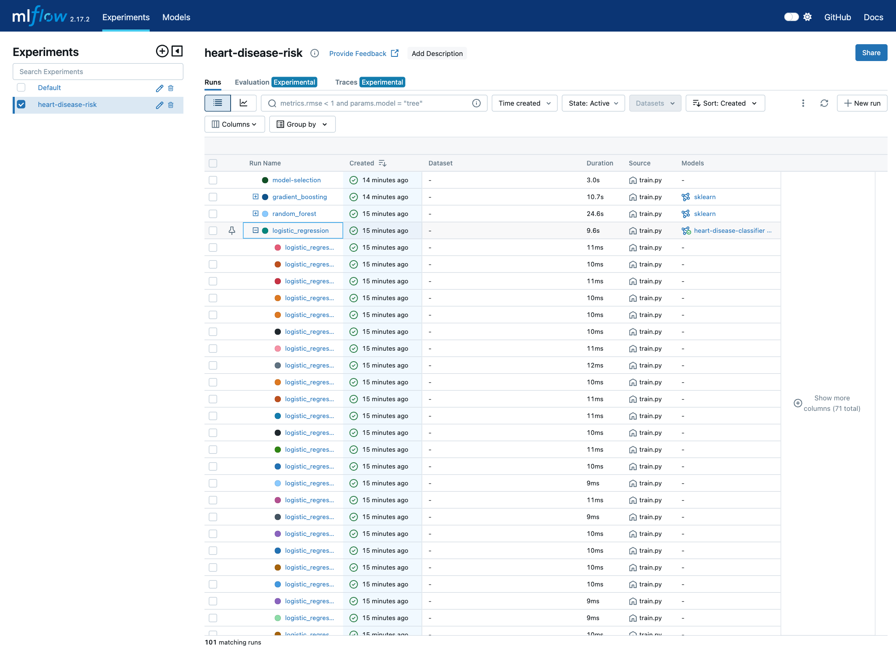 | 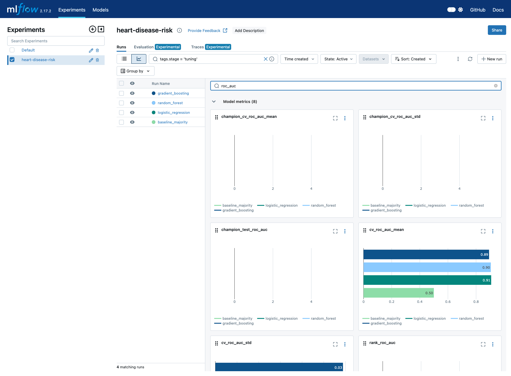 |
| 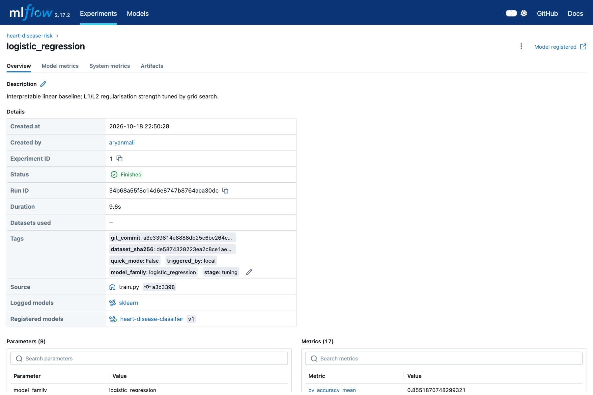 | 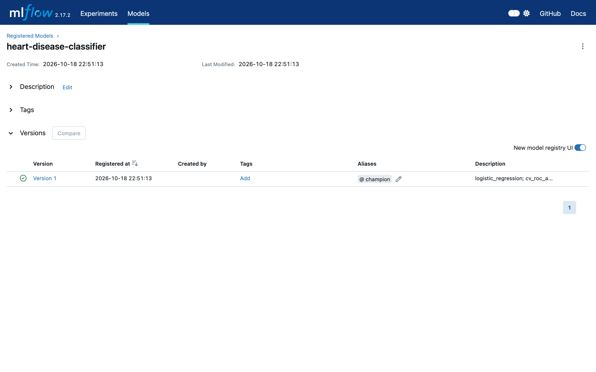 |

In CI the same training run happens on GitHub's runner, and `mlruns/` plus `mlflow.db` are uploaded as the
`mlflow-tracking` artifact of every workflow run. Each pipeline run therefore leaves a browsable experiment record.

## 9. Model packaging and reproducibility

- **Formats:**
  - `models/model.joblib` holds the full fitted pipeline (feature builder + preprocessing + classifier) and is what the API loads.
  - `models/mlflow_model/` is the MLflow sklearn/pyfunc flavour with `MLmodel`, `conda.yaml`, `requirements.txt` and an
    input example. It can be served with `mlflow models serve`.
- **Metadata:** `model_metadata.json` records model family, version, MLflow run id, registry version, training time,
  git commit, dataset SHA-256, decision threshold, feature order, best parameters, all CV and test metrics, and the
  Python and sklearn versions.
- **Environment:**
  - `requirements.txt`: the pinned runtime for training and serving.
  - `requirements-dev.txt`: adds test, lint and notebook tools.
  - `requirements-serve.txt`: the minimal set baked into Docker, with the same versions so the pickle loads identically.
  - `environment.yml`: the conda equivalent.
  - SQLAlchemy and alembic are pinned explicitly, because a newer SQLAlchemy breaks MLflow 2.17. This was found while
    installing from scratch.
- **Determinism:** `random_state = 42` is used for every split, CV and model, and the dataset is checksum-verified.
  Re-running training in a fresh copy of the repository reproduced the same champion and metrics, and the exported
  `model.joblib` had an identical SHA-256. On the Linux CI runner, logistic regression and random forest metrics are
  identical to the macOS run. Gradient boosting differs only in the third decimal (CV AUC 0.893 vs 0.892) because of
  floating-point differences between platforms.

## 10. CI/CD pipeline and automated testing

**Tests (`test/`, 45 tests, 89 % line coverage).**

| File | Tests | What is verified |
|---|---|---|
| `test_data.py` | 10 | `?` parsing; target binarisation; duplicate removal and report counts; out-of-range and invalid codes become NaN; download reuses a verified file without network access, falls back to the next mirror, and fails with a clear error |
| `test_features.py` | 7 | engineered values are correct; the switch-off case is an identity; input is not mutated; no NaN after preprocessing; scaling and one-hot shapes; unseen categories; works without engineered features |
| `test_model.py` | 16 | LR/RF pipelines output valid probabilities; CV AUC > 0.85 (beats baseline); metric edge cases; pickle round-trip; feature importances; risk bands; missing optional fields; committed artifacts are consistent; end-to-end `src.train` smoke run in quick mode with an isolated MLflow store (also checks it never overwrites `models/`) |
| `test_api.py` | 12 | root, health, readiness; `/predict` contract (prediction, confidence, risk); request-id propagation; float/string codes; 422 for bad codes, out-of-range values, missing or extra fields; batch endpoint; `/metrics` content; `/model/info`; 503 when the model is missing |

**Workflow (`.github/workflows/ci.yml`).** It runs on push and pull request to `main`, plus manual dispatch. Every step runs
under `bash -eo pipefail`, so any failing command fails the job, and downstream jobs are skipped through `needs:`.

| Job | Steps | Artifacts |
|---|---|---|
| 1 Lint | `ruff check`, `ruff format --check`, `helm lint` (default + CI values), render kustomize/Helm manifests | rendered-manifests |
| 2 Unit tests | clean `pip install -r requirements-dev.txt`, dataset verification, `pytest` with JUnit XML and coverage, results table in the job summary | test-reports |
| 3 Train | data → EDA → `src.train` (MLflow) → **quality gate** (fails if CV or test AUC < 0.85 or test recall < 0.75) → comparison table in the job summary | model, mlflow-tracking |
| 4 Docker | build with the model from job 3 (buildx + GHA cache), run the container, `smoke_test.sh` (health, predict, 422, metrics), record the health status | docker-image, docker-logs |
| 5 Deploy (kind) | create a kind cluster, load the image, server-side dry-run of the raw manifests, `helm upgrade --install --wait`, `helm test`, smoke test through port-forward, dump cluster state | k8s-deploy-logs |
| 6 Publish | push to `ghcr.io/rutuja-arwade/heart-disease-api:{1.0.0, latest, sha}` (only on push to main) | - |

**Failure behaviour, demonstrated.** Pull request #1 deliberately moved the low/moderate risk boundary from 0.30 to
0.35. The test job failed with a precise message (`FAILED test_model.py::test_risk_level_bands[0.3-moderate] -
AssertionError: assert 'low' == 'moderate'`, "1 failed, 44 passed"), and train, Docker, deploy and publish were all
**skipped** (Figure 32). The PR was closed unmerged. Successful runs on `main` take 7-9 minutes.

| | |
|---|---|
| 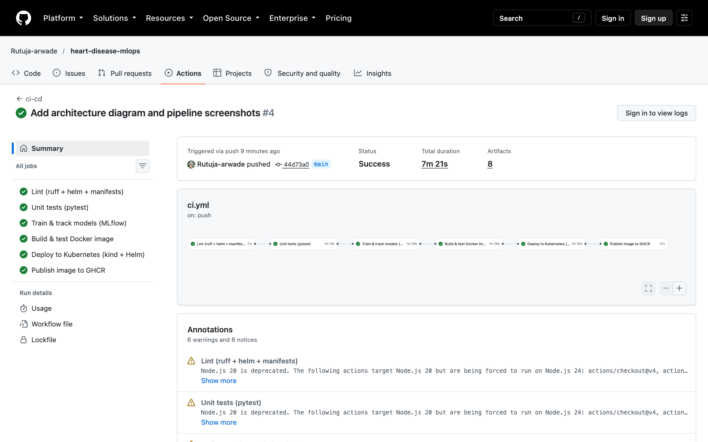 | 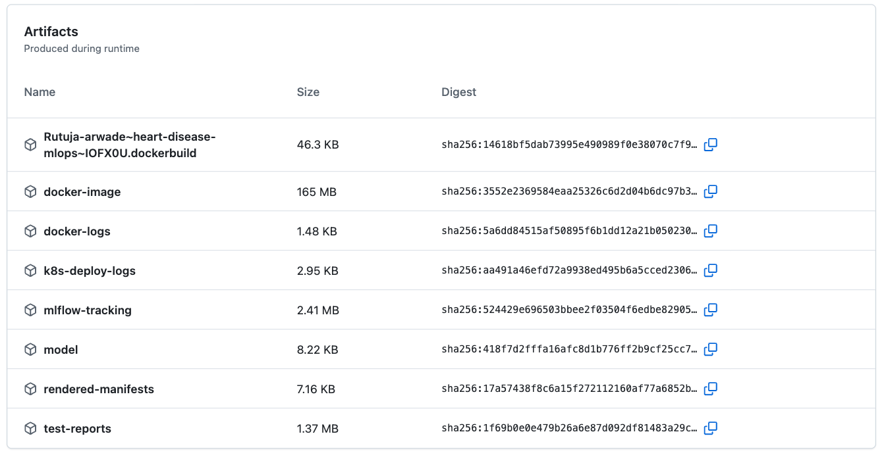 |
| 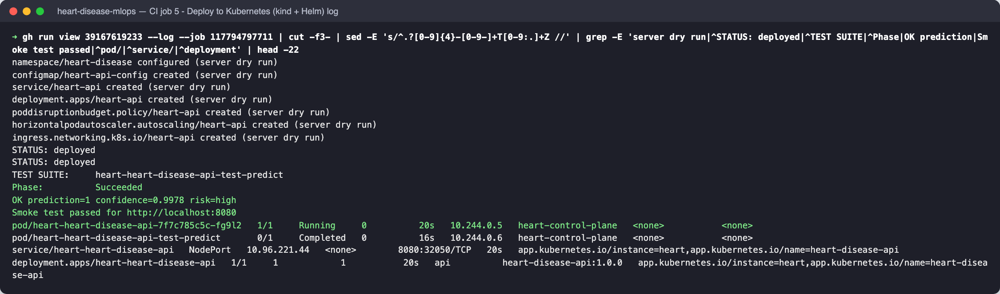 | 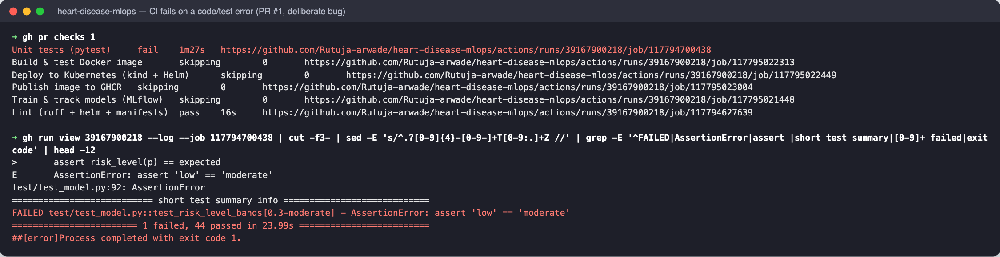 |

More CI evidence (pytest log, training log, Docker smoke-test log, job steps) is in `screenshots/29*.png`.

## 11. Model containerisation

**Dockerfile.**

- Multi-stage build: a builder stage creates a virtualenv from `requirements-serve.txt`, and the `python:3.11-slim`
  runtime stage copies only that venv, `src/` and the two model files. The image is 169 MB.
- Runs as non-root UID 10001.
- OCI labels record the version and git commit.
- A `HEALTHCHECK` calls `/ready`.
- `PORT` and `WORKERS` are environment-configurable. A single uvicorn worker per container is used, and scaling happens
  through replicas, which keeps the Prometheus counters per-process consistent.

| Endpoint | Purpose |
|---|---|
| `POST /predict` | JSON with the 13 attributes (`ca` and `thal` optional). Returns `prediction` (0/1), `label`, **`confidence`** (probability of the predicted class), `probability_disease`, `risk_level` (low < 0.3 ≤ moderate < 0.6 ≤ high), `threshold`, `model_version` and `request_id` |
| `POST /predict/batch` | up to 500 records |
| `GET /health`, `GET /ready` | liveness and readiness (503 until the model is loaded) |
| `GET /model/info` | metadata of the served model |
| `GET /metrics` | Prometheus exposition format |

**Validation.** Pydantic enforces allowed category codes, numeric ranges and no unknown fields. Integral floats and strings
(`1.0`, `"4"`) are accepted for codes. Invalid requests get HTTP 422 with field-level messages.

```json
POST /predict  {"age":63,"sex":1,"cp":4,"trestbps":150,"chol":286,"fbs":0,"restecg":2,
                "thalach":108,"exang":1,"oldpeak":1.5,"slope":2,"ca":3,"thal":7}
200 OK         {"request_id":"97606faf19c640b8","prediction":1,"label":"heart_disease","confidence":0.9978,
                "probability_disease":0.9978,"risk_level":"high","threshold":0.5,
                "model_version":"1.0.0+logistic_regression"}
```

| | |
|---|---|
| 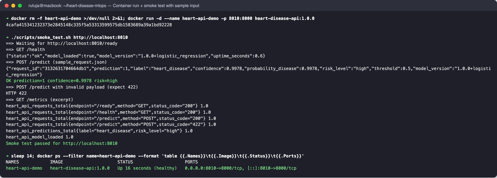 | 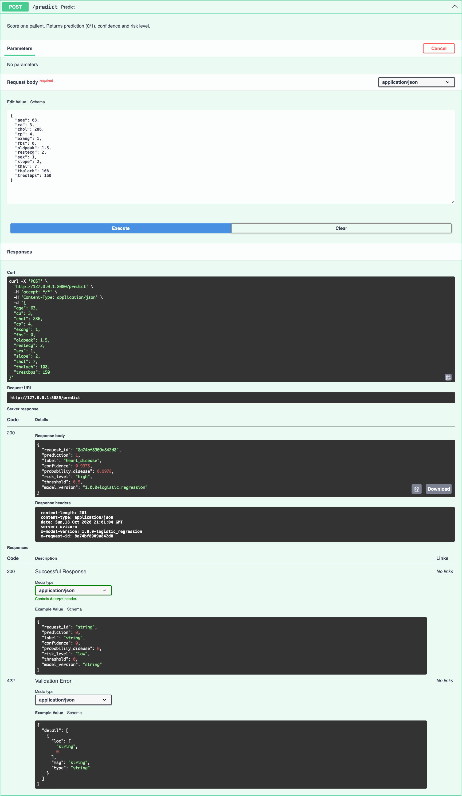 |

## 12. Production deployment (Kubernetes, Minikube)

**Cluster.** Minikube (Kubernetes v1.31.0, docker driver) with the `ingress` and `metrics-server` add-ons. The image was loaded with
`minikube image load`. In CI the same chart deploys to kind.

**Helm chart `deploy/helm/heart-disease-api`:**

- Deployment: 2 replicas; RollingUpdate with `maxUnavailable: 0`; startup, readiness and liveness probes; resource
  requests and limits; Prometheus scrape annotations; a config checksum annotation that rolls pods on config change.
- Pod security: `runAsNonRoot`, UID/GID 10001, `readOnlyRootFilesystem`, all capabilities dropped, `seccomp RuntimeDefault`,
  service-account token not mounted.
- Other objects: ConfigMap, ServiceAccount, Service (`LoadBalancer`, port 8080), NGINX Ingress (`heart-api.local`),
  HPA (2-5 replicas at 70 % CPU), PodDisruptionBudget (`minAvailable: 1`) and a `helm test` hook that calls `/predict`
  from inside the cluster.
- `values-ci.yaml` switches to a single NodePort replica for kind.
- The same objects also exist as plain manifests in `deploy/k8s` (`kubectl apply -k deploy/k8s`).

**Exposure and verification.**

- `minikube tunnel` assigns the LoadBalancer `EXTERNAL-IP 127.0.0.1:8080`.
- The Ingress (address 192.168.49.2) routes `Host: heart-api.local` to the Service.
- Both paths were verified with `smoke_test.sh` and with real `/predict` calls (high-risk patient → 1 with 0.998
  confidence; low-risk patient → 0 with 0.923 confidence). `helm test` passed.
- A 600-request load test through the LoadBalancer completed with no 5xx errors.
- A `kubectl rollout restart` with a rebuilt image replaced the pods one at a time (`maxUnavailable: 0`).

| | |
|---|---|
| 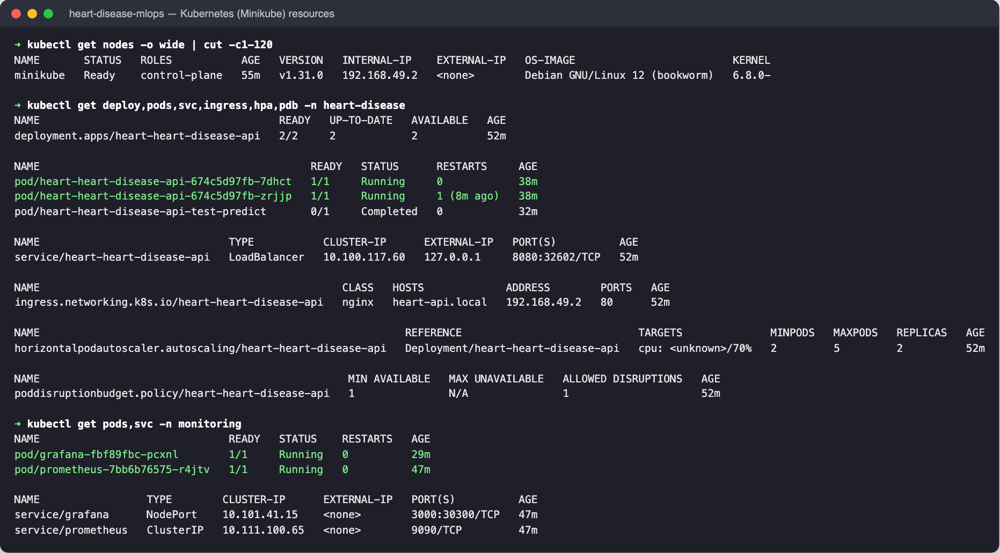 | 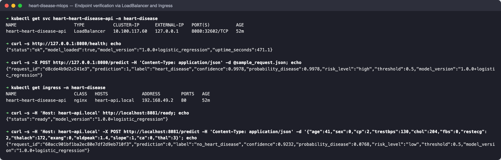 |

## 13. Monitoring and logging

- **Request logging.** An HTTP middleware writes one JSON line per request with `ts`, `request_id` (taken from or returned as
  `X-Request-ID`), method, path, status, `duration_ms`, client and user agent. A second line per prediction holds the
  model version, prediction, probability, risk level and input features. Validation failures are logged with field details.
  Logs go to stdout (`kubectl logs`, ready for Loki or ELK). In docker-compose they also go to a file through `LOG_FILE`.
- **Metrics (`/metrics`):**

  | Metric | Type | Labels |
  |---|---|---|
  | `heart_api_requests_total` | counter | method, endpoint, status_code |
  | `heart_api_request_duration_seconds` | histogram | method, endpoint |
  | `heart_api_requests_in_progress` | gauge | |
  | `heart_api_predictions_total` | counter | label, risk_level |
  | `heart_api_prediction_probability` | histogram (drift signal) | |
  | `heart_api_inference_duration_seconds` | histogram | |
  | `heart_api_validation_errors_total` | counter | endpoint |
  | `heart_api_model_loaded`, `heart_api_model_info` | gauge, info | version, family, run id |

  Endpoint labels use the route template, which keeps cardinality bounded.
- **Prometheus** (namespace `monitoring`) discovers API pods through `kubernetes_sd` and the `prometheus.io/*`
  annotations, with RBAC limited to get/list/watch on pods, services and endpoints. Both pods were scraped as `up`. Alert rules cover target down,
  model not loaded, 5xx rate above 5 %, p95 latency above 500 ms, and mean predicted probability above 0.75 for 30 minutes
  (input drift).
- **Grafana** is provisioned from code: the datasource, the dashboard provider and the dashboard JSON (shared by
  Kubernetes and docker-compose). The 14 panels cover model status, scraped targets, predictions served, request rate,
  non-2xx share, p95 latency, request rate by endpoint and status, p50/p95/p99 latency, outcome split, risk bands, mean
  predicted probability, predictions per second, 422 rate and in-flight requests.

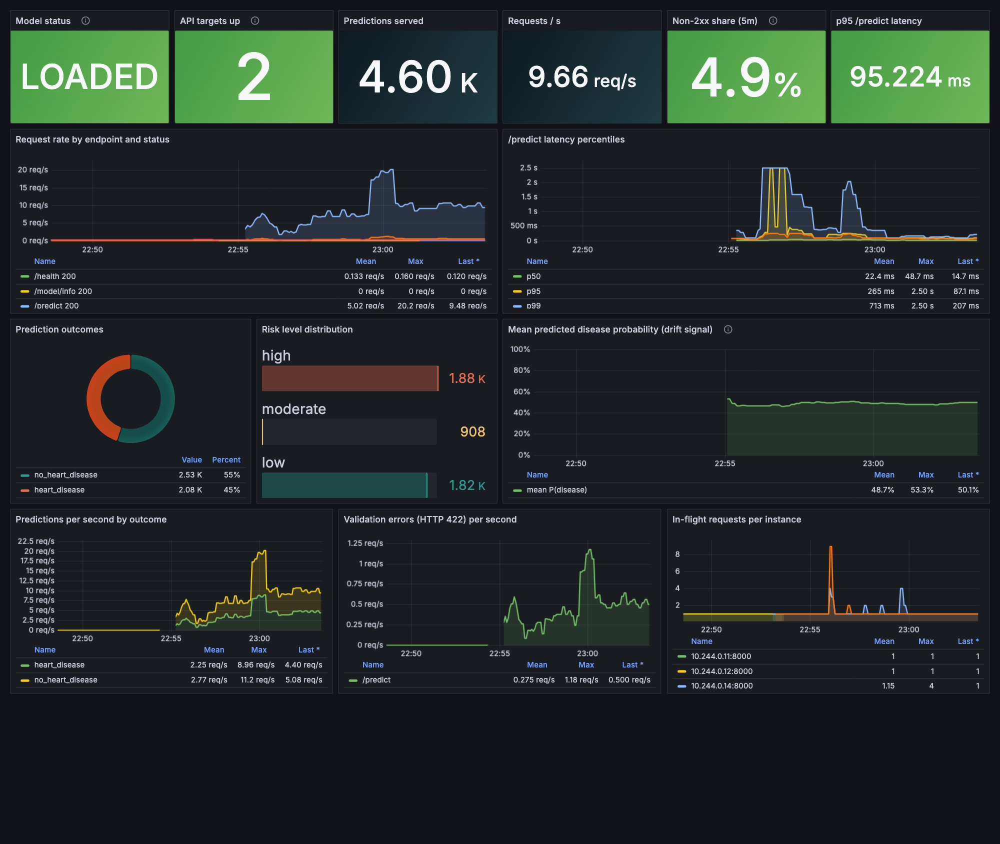

| | |
|---|---|
| 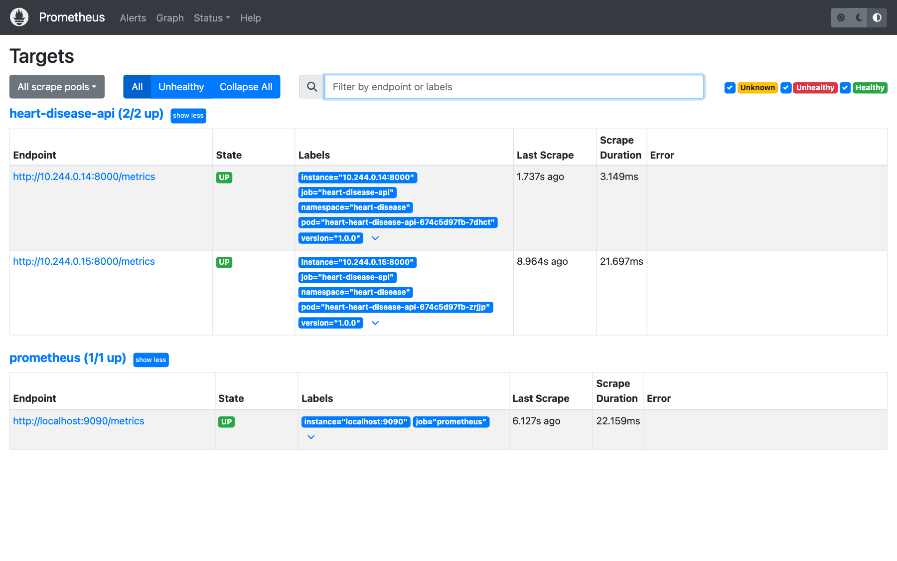 | 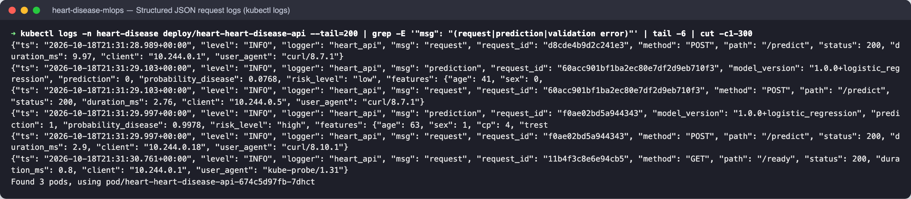 |

## 14. Challenges, decisions and limitations

| Issue | Resolution |
|---|---|
| MLflow 2.17 failed to start with SQLAlchemy 2.1 (`FallbackAsyncAdaptedQueuePool` import error) | pinned `sqlalchemy==2.0.36` and `alembic==1.14.0`, found by the clean-setup install |
| Pods stuck in `CreateContainerConfigError` (`runAsNonRoot` with a named user) | numeric `USER 10001:10001` in the Dockerfile and `runAsUser` in the pod spec |
| Training INFO logs disappeared on a fresh MLflow DB: alembic migrations call `logging.config.fileConfig` | the tracking store is initialised before logging is configured, and the logger is re-enabled |
| Compose API crashed: the named log volume was owned by root | `/app/logs` is created with the app's ownership in the image, and the file log sink became fail-safe |
| `minikube tunnel` needs sudo for ports below 1024 | the LoadBalancer listens on 8080; the Ingress was verified through a port-forward with a Host header |
| Test leakage risk from imputation | imputation lives inside the CV pipeline, and model selection uses CV only (never the test set) |

**Limitations and next steps.**

- The dataset has only 303 patients from one hospital. Hold-out metrics on 61 patients have wide confidence intervals,
  so external validation (for example on the Hungarian or VA subsets) is needed before clinical use.
- The decision threshold is fixed at 0.5. A cost-sensitive threshold tuned for recall would suit screening.
- Next steps:
  - Calibration (isotonic) and probability-quality monitoring.
  - Data-drift detection on input features, for example with Evidently.
  - Model promotion driven by the registry alias instead of the image.
  - Pushing the image to a managed cluster (GKE/EKS) with TLS on the Ingress.
  - Persistent Prometheus storage and Alertmanager routing.

## 15. Deliverables checklist

| Requirement | Location |
|---|---|
| Code, Dockerfile, requirements / env file | `src/`, `Dockerfile`, `requirements*.txt`, `environment.yml` |
| Cleaned dataset + download script / instructions | `data/processed/heart_disease_clean.csv`, `scripts/download_data.sh`, `data/README.md` |
| Notebooks / scripts for EDA, training, inference | `notebooks/01_eda.ipynb`, `02_model_training.ipynb`, `03_inference.ipynb`; `src/eda.py`, `src/train.py`, `src/predict.py` |
| `test/` folder with unit tests | `test/` (45 tests) |
| GitHub Actions workflow | `.github/workflows/ci.yml` |
| Deployment manifests / Helm chart | `deploy/k8s/`, `deploy/helm/heart-disease-api/`, `monitoring/` |
| Screenshot folder | `screenshots/` (one or more screenshots per stage, listed in `screenshots/README.md`) |
| Final report | `docs/report/REPORT.md` (draft), `report.docx`, `report.pdf` |
| Deployed API / access instructions | Section 3 (local Minikube, LoadBalancer `127.0.0.1:8080`, Ingress `heart-api.local`); image on GHCR |
| Video of the pipeline | `docs/video/pipeline_walkthrough.mp4` |
